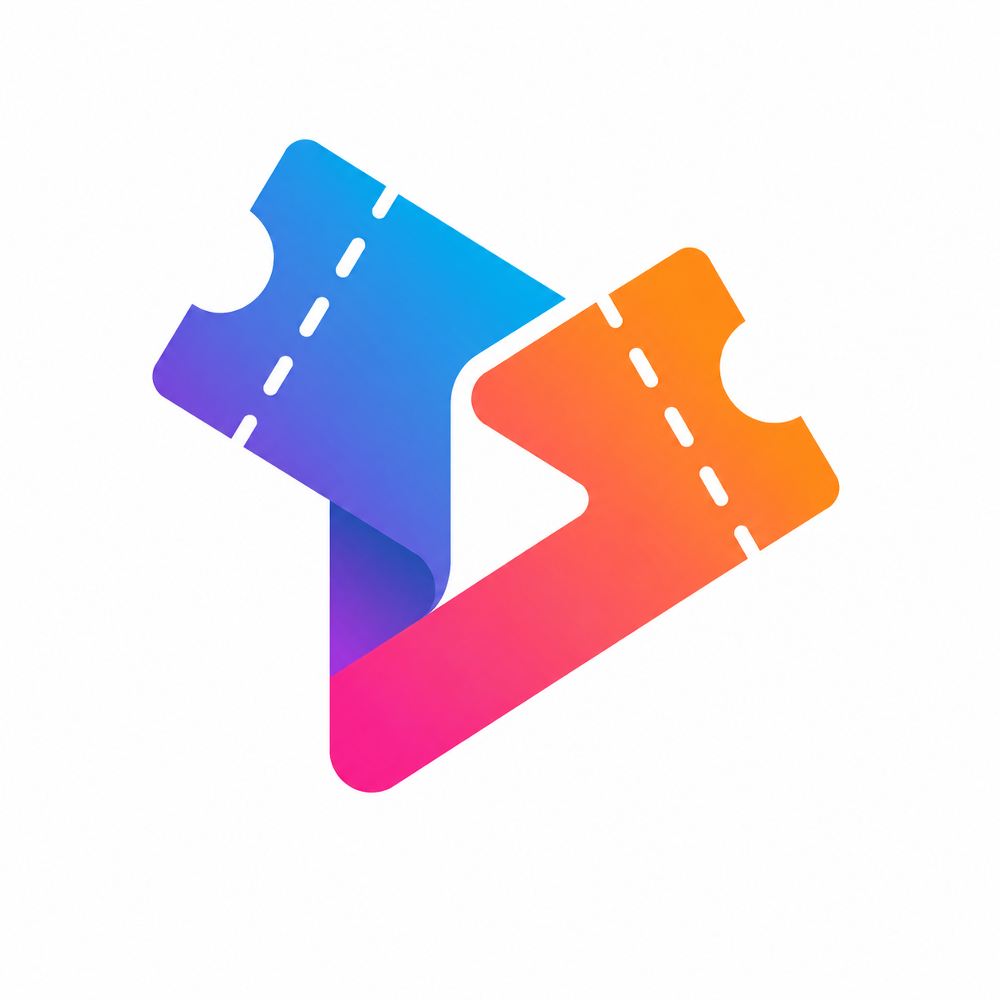

```sh
Utilize o site <https://www.toptal.com/developers/gitignore> para gerar seu arquivo gitignore e apague este campo.

Vide tutoriais do PI.
```

# FECAP - Fundação de Comércio Álvares Penteado

<p align="center">
<a href= "https://www.fecap.br/"></a>
</p>

# InterLink

## InterLink

## Integrantes: <a href="https://www.linkedin.com/in/alanas-rocha/">Alana Silva Rocha</a>, <a href="https://github.com/BrunaClara">Bruna Clara da Silva Morais</a>, <a href="www.linkedin.com/in/geovanna-tamagusko">Geovanna V. M. R. Tamagusko</a>, <a href="https://github.com/juliaandmed">Julia de Andrade Medeiros</a>

## Professores Orientadores: <a href="https://www.linkedin.com/in/cristina-machado-corr%C3%AAa-leite-630309160/">Cristina Machado Correa Leite</a>, <a href="https://www.linkedin.com/in/dolemes/">David De Oliveira Lemes</a>, <a href="https://www.linkedin.com/in/francisco-escobar/">Francisco de Souza Escobar</a>, <a href="https://www.linkedin.com/in/j%C3%A9sus-de-lisboa-gomes-8b527a282/">Jesus De Lisboa Gomes</a>, <a href="https://www.linkedin.com/in/katia-bossi/">Katia Milani Lara Bossi</a>

## Descrição
<div style="text-align: center;">
<p style="text-align: center;">
 <br>
  Site by <a href="https://github.com/2026-2-MCC2/Projeto4.git/">InterLink</a> <a rel="license" href="https://creativecommons.org/licenses/by-sa/4.0/">CC BY-SA 4.0</a>
</p>
</div>


O InterLink (TrocaTicket) é um marketplace de ingressos que conecta clientes, organizadores de eventos e fornecedores de serviços em um único fluxo seguro. Organizadores planejam e publicam seus eventos para venda, fornecedores cotam e fornecem os serviços necessários para a realização deles, e clientes compram ingressos oficiais diretamente na plataforma.
<br><br>
Além da venda primária, o sistema permite que clientes revendam ingressos que não poderão mais usar, com pagamentos protegidos por custódia até a validação do acesso no evento, e negociem o preço anunciado por meio de contrapropostas. Toda a operação é supervisionada por um painel administrativo, que aprova cadastros, audita logs e monitora a saúde da plataforma.
<br><br>

## Entregas

- [Modelagem do Banco de Dados](./documentos/entrega1/Projetos%20em%20Banco%20de%20Dados/README.md)

## 🌐 Acesse o projeto

   <p align="center">
     <a href="https://projeto4-bckx.onrender.com"></a>
   </p>

   🔗 **Link:** <https://projeto4-bckx.onrender.com>

   > Front-end (React + Vite) hospedado como Static Site no Render, com deploy automático a cada commit na branch `main`.  

## 🛠 Estrutura de pastas

<b>-Raiz</b><br>
|<br>
|--> <b>documentos</b><br>
|<br>
|--> <b>src</b><br>
&emsp;|--> <b>entrega1</b><br>
&emsp;&emsp;|--> <b>frontend</b><br>
&emsp;&emsp;&emsp;|--> index.html<br>
&emsp;&emsp;&emsp;|--> contas-teste.json<br>
&emsp;&emsp;&emsp;|--> servidor-estatico.js<br>
&emsp;&emsp;&emsp;|<br>
&emsp;&emsp;&emsp;|--> <b>images</b><br>
&emsp;&emsp;&emsp;&emsp;|--> logo_navbar_web.png<br>
&emsp;&emsp;&emsp;&emsp;|--> logo_troca_ticket.png<br>
&emsp;&emsp;&emsp;&emsp;|--> logotipo_troca_ticket.png<br>
&emsp;&emsp;&emsp;&emsp;|--> <b>eventos</b> (evento-1.jpg a evento-4.jpg)<br>
&emsp;&emsp;&emsp;|<br>
&emsp;&emsp;&emsp;|--> <b>pages</b><br>
&emsp;&emsp;&emsp;&emsp;|--> login.html<br>
&emsp;&emsp;&emsp;&emsp;|--> cadastro.html<br>
&emsp;&emsp;&emsp;&emsp;|--> eventos.html<br>
&emsp;&emsp;&emsp;&emsp;|--> ingressos-revenda.html<br>
&emsp;&emsp;&emsp;&emsp;|<br>
&emsp;&emsp;&emsp;&emsp;|--> <b>css</b><br>
&emsp;&emsp;&emsp;&emsp;&emsp;|--> style.css<br>
&emsp;&emsp;&emsp;&emsp;|<br>
&emsp;&emsp;&emsp;&emsp;|--> <b>cliente</b><br>
&emsp;&emsp;&emsp;&emsp;&emsp;|--> inicio.html<br>
&emsp;&emsp;&emsp;&emsp;&emsp;|--> ingressos.html<br>
&emsp;&emsp;&emsp;&emsp;&emsp;|--> ver-ingresso.html<br>
&emsp;&emsp;&emsp;&emsp;&emsp;|--> compras.html<br>
&emsp;&emsp;&emsp;&emsp;&emsp;|--> perfil.html<br>
&emsp;&emsp;&emsp;&emsp;&emsp;|--> seus-ingressos.html<br>
&emsp;&emsp;&emsp;&emsp;&emsp;|--> suas-revendas.html<br>
&emsp;&emsp;&emsp;&emsp;&emsp;|--> configuracoes.html<br>
&emsp;&emsp;&emsp;&emsp;&emsp;|--> 404.html<br>
&emsp;&emsp;&emsp;&emsp;&emsp;|--> <b>js</b> (mock-api.js, pagina-ingressos.js, pagina-ver-ingresso.js)<br>
&emsp;&emsp;&emsp;&emsp;|<br>
&emsp;&emsp;&emsp;&emsp;|--> <b>Fornecedor</b><br>
&emsp;&emsp;&emsp;&emsp;&emsp;|--> dashboard.html<br>
&emsp;&emsp;&emsp;&emsp;&emsp;|--> busca.html<br>
&emsp;&emsp;&emsp;&emsp;&emsp;|--> propostas.html<br>
&emsp;&emsp;&emsp;&emsp;&emsp;|--> eventos.html<br>
&emsp;&emsp;&emsp;&emsp;&emsp;|--> fornecedores.html<br>
&emsp;&emsp;&emsp;&emsp;&emsp;|--> cadastro.html<br>
&emsp;&emsp;&emsp;&emsp;&emsp;|--> style.css<br>
&emsp;&emsp;&emsp;&emsp;|<br>
&emsp;&emsp;&emsp;&emsp;|--> <b>admin</b><br>
&emsp;&emsp;&emsp;&emsp;&emsp;|--> login.html<br>
&emsp;&emsp;&emsp;&emsp;&emsp;|--> dashboard.html<br>
&emsp;&emsp;&emsp;&emsp;&emsp;|--> usuarios.html<br>
&emsp;&emsp;&emsp;&emsp;&emsp;|--> papeis.html<br>
&emsp;&emsp;&emsp;&emsp;&emsp;|--> configuracoes.html<br>
&emsp;&emsp;&emsp;&emsp;&emsp;|--> logs.html<br>
&emsp;&emsp;&emsp;&emsp;&emsp;|--> monitoramento.html<br>
&emsp;&emsp;&emsp;&emsp;&emsp;|--> tickets.html<br>
&emsp;|<br>
|<br>
|--> <b>README.md</b><br>     

A pasta raiz contem dois arquivos que devem ser alterados:

<b>README.MD</b>: Arquivo que serve como guia e explicação geral sobre seu projeto. O mesmo que você está lendo agora.

Há também 4 pastas que seguem da seguinte forma:

<b>documentos</b>: Toda a documentação estará nesta pasta.

<b>imagens</b>: Imagens e  icones do site

<b>src</b>: Pasta que contém o código fonte.

## 📋 Licença/License
https://creativecommons.org/licenses/by-sa/4.0/

## 🤖 Declaração de Uso de IA

Conforme o **Guia para o Uso Responsável de Inteligência Artificial na FECAP** (Protocolo FECAP IA, versão 2.0, 29/07/2026), Art. 6º e 7º.

| Campo | Preenchimento |
|---|---|
| **Ferramenta utilizada** | Claude Code (CLI/IDE da Anthropic) |
| **Versão/modelo** | Claude Sonnet 5 (`claude-sonnet-5`) |
| **Disciplina / Trabalho** | Desenvolvimento Web Full Stack — Entrega 2 (projeto InterLink/TrocaTicket) |
| **Finalidade de uso** | Suporte técnico de depuração (debugging) em uma aplicação já desenvolvida pela equipe: diagnóstico de falhas de conexão entre frontend e backend (CORS, variáveis de ambiente de produção no Render), correção de roteamento client-side (SPA) em produção, e correção de bugs de interface (abas da tela de Configurações do Admin que não filtravam o conteúdo exibido, tabela sem rolagem horizontal cortando colunas, botão "Sair da Conta" com CSS vazado e preso no rodapé da página). |
| **Prompts principais utilizados** | "o problema do fetch voltou a dar", "o problema está dando no link do render", "achei mais bugs", pedidos de diagnóstico e correção de erros específicos relatados pela autora durante testes manuais da aplicação (console do navegador, telas de login, configurações e menus laterais). |
| **Trechos ou entregas afetadas** | `src/entrega2/backend/src/app.js` (diagnóstico); variável de ambiente `FRONTEND_URL` no serviço de backend no Render (ajuste de configuração, fora do versionamento); `src/entrega2/frontend/public/_redirects` (rewrite de rotas SPA); `src/entrega2/frontend/src/paginas/admin/AdminConfiguracoes.jsx` (exibição condicional por aba); `src/entrega2/frontend/src/styles/base.css`, `admin.css`, `cliente.css`, `organizador.css`, `fornecedor.css` (escopo do CSS vazado e menus laterais fixos). |

Declaro que o uso acima descrito está em conformidade com o Guia para o Uso Responsável de Inteligência Artificial na FECAP e que o conteúdo final do projeto é de responsabilidade autoral da equipe, que revisou e validou todas as alterações técnicas antes de aplicá-las.

**Equipe:** Alana Silva Rocha, Bruna Clara da Silva Morais, Geovanna V. M. R. Tamagusko, Julia de Andrade Medeiros
**Data:** 03/11/2026

## 🎓 Referências

Aqui estão as referências usadas no projeto.

1. <https://github.com/TCTK1/TrocaTicket-Assets>
2. 
3. 
4. 
5. 