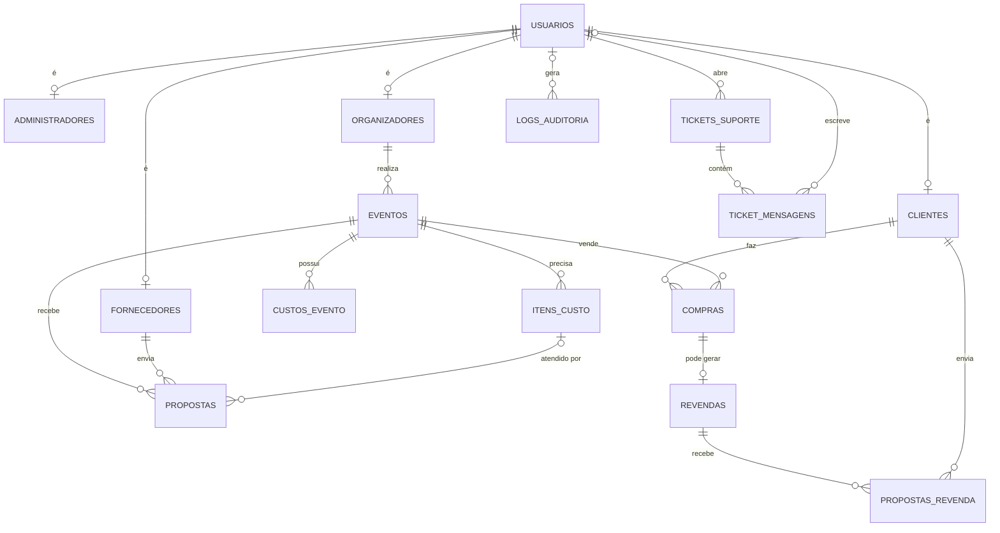

# Banco de Dados

**SGBD:** PostgreSQL (hospedado no Supabase)

O banco possui 16 tabelas, organizadas em quatro grupos: usuários e perfis, eventos e fornecedores, vendas e revenda de ingressos, e suporte e auditoria. Todas as chaves primárias são `INTEGER GENERATED ALWAYS AS IDENTITY`, ou seja, numeradas automaticamente pelo banco.

## Diagrama de relacionamentos

---

## 1. Usuários e perfis

### `usuarios`
Dados comuns a todos os usuários. Funciona como superclasse dos perfis.

| Campo | Tipo | Restrições | Descrição |
|---|---|---|---|
| id_usuario | INTEGER | **PK**, IDENTITY | Identificador do usuário |
| nome | VARCHAR | NOT NULL | Nome completo |
| email | VARCHAR | NOT NULL, UNIQUE | E-mail de login |
| telefone | VARCHAR | — | Telefone de contato |
| senha_hash | VARCHAR | NOT NULL | Senha criptografada |
| tipo | VARCHAR | NOT NULL, CHECK | `administrador`, `organizador`, `cliente` ou `fornecedor` |
| status_cadastro | VARCHAR | NOT NULL, padrão `pendente`, CHECK | `pendente`, `aprovado` ou `recusado` |
| criado_em | TIMESTAMPTZ | NOT NULL, padrão `now()` | Data de cadastro |

### `administradores`
| Campo | Tipo | Restrições | Descrição |
|---|---|---|---|
| id_administrador | INTEGER | **PK**, IDENTITY | Identificador do administrador |
| id_usuario | INTEGER | NOT NULL, UNIQUE, **FK** → usuarios | Usuário correspondente |
| nivel_acesso | VARCHAR | NOT NULL, padrão `suporte` | Nível de permissão |

### `organizadores`
| Campo | Tipo | Restrições | Descrição |
|---|---|---|---|
| id_organizador | INTEGER | **PK**, IDENTITY | Identificador do organizador |
| id_usuario | INTEGER | NOT NULL, UNIQUE, **FK** → usuarios | Usuário correspondente |
| cnpj | CHAR | NOT NULL, UNIQUE | CNPJ |
| endereco | VARCHAR | — | Endereço |

### `clientes`
| Campo | Tipo | Restrições | Descrição |
|---|---|---|---|
| id_cliente | INTEGER | **PK**, IDENTITY | Identificador do cliente |
| id_usuario | INTEGER | NOT NULL, UNIQUE, **FK** → usuarios | Usuário correspondente |
| cpf | CHAR | NOT NULL, UNIQUE | CPF |

### `fornecedores`
| Campo | Tipo | Restrições | Descrição |
|---|---|---|---|
| id_fornecedor | INTEGER | **PK**, IDENTITY | Identificador do fornecedor |
| id_usuario | INTEGER | NOT NULL, UNIQUE, **FK** → usuarios | Usuário correspondente |
| cnpj | CHAR | NOT NULL, UNIQUE | CNPJ |
| endereco | VARCHAR | — | Endereço |

---

## 2. Eventos e fornecedores

### `eventos`
Evento criado por um organizador. O preço do ingresso é calculado a partir dos custos e da margem de lucro.

| Campo | Tipo | Restrições | Descrição |
|---|---|---|---|
| id_evento | INTEGER | **PK**, IDENTITY | Identificador do evento |
| id_organizador | INTEGER | NOT NULL, **FK** → organizadores | Organizador responsável |
| nome | VARCHAR | NOT NULL | Nome do evento |
| data | DATE | NOT NULL | Data de início |
| data_fim | DATE | — | Data de término |
| local | VARCHAR | — | Local de realização |
| descricao | TEXT | — | Descrição |
| categoria | VARCHAR | — | Categoria do evento |
| imagem_url | VARCHAR | — | URL da imagem de divulgação |
| capacidade | INTEGER | — | Capacidade do local |
| publico_minimo | INTEGER | — | Público mínimo esperado |
| publico_maximo | INTEGER | — | Público máximo esperado |
| margem_lucro | NUMERIC | NOT NULL, padrão 0, CHECK 0 ≤ x < 100 | Margem de lucro (%) |
| preco_ingresso | NUMERIC | — | Preço calculado do ingresso |
| ingressos_total | INTEGER | — | Total de ingressos disponíveis |
| ingressos_vendidos | INTEGER | NOT NULL, padrão 0 | Ingressos já vendidos |
| publicado_para_venda | BOOLEAN | NOT NULL, padrão `false` | Indica se a venda está aberta |
| status | VARCHAR | NOT NULL, padrão `rascunho`, CHECK | `rascunho`, `aberto`, `fechado` ou `cancelado` |

### `itens_custo`
Itens que o evento precisa contratar.

| Campo | Tipo | Restrições | Descrição |
|---|---|---|---|
| id_item | INTEGER | **PK**, IDENTITY | Identificador do item |
| id_evento | INTEGER | NOT NULL, **FK** → eventos | Evento que precisa do item |
| nome | VARCHAR | NOT NULL | Nome do item |
| categoria | VARCHAR | NOT NULL, CHECK | `iluminacao`, `alimentacao`, `bebida`, `seguranca`, `estrutura` ou `outros` |
| descricao | TEXT | — | Detalhes |
| criado_em | TIMESTAMPTZ | NOT NULL, padrão `now()` | Data de criação |

### `custos_evento`
Demais custos do evento, que entram no cálculo do preço do ingresso.

| Campo | Tipo | Restrições | Descrição |
|---|---|---|---|
| id_custo | INTEGER | **PK**, IDENTITY | Identificador do custo |
| id_evento | INTEGER | NOT NULL, **FK** → eventos | Evento relacionado |
| tipo | VARCHAR | NOT NULL, CHECK | `fiscal`, `operacional`, `variavel` ou `outro` |
| descricao | VARCHAR | NOT NULL | Descrição do custo |
| valor | NUMERIC | NOT NULL, CHECK ≥ 0 | Valor |
| por_participante | BOOLEAN | NOT NULL, padrão `false` | Indica se o custo é cobrado por pessoa |
| criado_em | TIMESTAMPTZ | NOT NULL, padrão `now()` | Data de criação |

### `propostas`
Proposta de um fornecedor para atender um evento.

| Campo | Tipo | Restrições | Descrição |
|---|---|---|---|
| id_proposta | INTEGER | **PK**, IDENTITY | Identificador da proposta |
| id_evento | INTEGER | NOT NULL, **FK** → eventos | Evento que recebe a proposta |
| id_fornecedor | INTEGER | NOT NULL, **FK** → fornecedores | Fornecedor que envia a proposta |
| id_item | INTEGER | **FK** → itens_custo | Item do evento atendido (opcional) |
| valor_total | NUMERIC | NOT NULL, padrão 0 | Valor total proposto |
| descricao | TEXT | — | Detalhes da proposta |
| observacoes | TEXT | — | Observações adicionais |
| data_proposta | DATE | NOT NULL, padrão data atual | Data de envio |
| data_entrega | DATE | — | Data prevista de entrega |
| validade | DATE | — | Validade da proposta |
| status | VARCHAR | NOT NULL, padrão `enviada`, CHECK | `enviada`, `aceita`, `recusada` ou `cancelada` |

---

## 3. Vendas e revenda de ingressos

### `compras`
| Campo | Tipo | Restrições | Descrição |
|---|---|---|---|
| id_compra | INTEGER | **PK**, IDENTITY | Identificador da compra |
| id_cliente | INTEGER | NOT NULL, **FK** → clientes | Cliente comprador |
| id_evento | INTEGER | NOT NULL, **FK** → eventos | Evento comprado |
| quantidade | INTEGER | NOT NULL, CHECK > 0 | Quantidade de ingressos |
| valor_unitario | NUMERIC | NOT NULL, CHECK > 0 | Preço por ingresso |
| valor_total | NUMERIC | NOT NULL, CHECK > 0 | Valor total |
| status | VARCHAR | NOT NULL, padrão `confirmada`, CHECK | `confirmada`, `cancelada` ou `revendida` |
| criado_em | TIMESTAMPTZ | NOT NULL, padrão `now()` | Data da compra |

### `revendas`
Anúncio de revenda de uma compra. Cada compra pode ter no máximo uma revenda.

| Campo | Tipo | Restrições | Descrição |
|---|---|---|---|
| id_revenda | INTEGER | **PK**, IDENTITY | Identificador da revenda |
| id_compra | INTEGER | NOT NULL, UNIQUE, **FK** → compras | Compra revendida |
| preco_unitario | NUMERIC | NOT NULL, CHECK > 0 | Preço pedido por ingresso |
| status | VARCHAR | NOT NULL, padrão `disponivel`, CHECK | `disponivel`, `vendida` ou `cancelada` |
| criado_em | TIMESTAMPTZ | NOT NULL, padrão `now()` | Data do anúncio |

### `propostas_revenda`
Ofertas de clientes por um ingresso em revenda.

| Campo | Tipo | Restrições | Descrição |
|---|---|---|---|
| id_proposta | INTEGER | **PK**, IDENTITY | Identificador da oferta |
| id_revenda | INTEGER | NOT NULL, **FK** → revendas | Revenda alvo |
| id_cliente | INTEGER | NOT NULL, **FK** → clientes | Cliente interessado |
| preco_proposto | NUMERIC | NOT NULL, CHECK > 0 | Valor oferecido |
| status | VARCHAR | NOT NULL, padrão `pendente`, CHECK | `pendente`, `aceita`, `recusada` ou `cancelada` |
| criado_em | TIMESTAMPTZ | NOT NULL, padrão `now()` | Data da oferta |

---

## 4. Suporte e auditoria

### `tickets_suporte`
| Campo | Tipo | Restrições | Descrição |
|---|---|---|---|
| id_ticket | INTEGER | **PK**, IDENTITY | Identificador do ticket |
| id_usuario | INTEGER | NOT NULL, **FK** → usuarios | Usuário que abriu o ticket |
| assunto | VARCHAR | NOT NULL | Assunto |
| categoria | VARCHAR | NOT NULL, CHECK | `evento`, `proposta`, `cadastro`, `financeiro` ou `outro` |
| prioridade | VARCHAR | NOT NULL, padrão `media`, CHECK | `alta`, `media` ou `baixa` |
| status | VARCHAR | NOT NULL, padrão `aberto`, CHECK | `aberto`, `em_andamento`, `resolvido` ou `fechado` |
| criado_em | TIMESTAMPTZ | NOT NULL, padrão `now()` | Data de abertura |
| atualizado_em | TIMESTAMPTZ | NOT NULL, padrão `now()` | Última atualização |

### `ticket_mensagens`
| Campo | Tipo | Restrições | Descrição |
|---|---|---|---|
| id_mensagem | INTEGER | **PK**, IDENTITY | Identificador da mensagem |
| id_ticket | INTEGER | NOT NULL, **FK** → tickets_suporte | Ticket da conversa |
| id_usuario | INTEGER | **FK** → usuarios | Autor da mensagem |
| mensagem | TEXT | NOT NULL | Conteúdo |
| criado_em | TIMESTAMPTZ | NOT NULL, padrão `now()` | Data de envio |

### `logs_auditoria`
| Campo | Tipo | Restrições | Descrição |
|---|---|---|---|
| id_log | INTEGER | **PK**, IDENTITY | Identificador do log |
| id_usuario | INTEGER | **FK** → usuarios | Usuário que executou a ação |
| acao | VARCHAR | NOT NULL | Ação realizada |
| detalhe | TEXT | — | Detalhes da ação |
| criado_em | TIMESTAMPTZ | NOT NULL, padrão `now()` | Data e hora |

---

## Decisões de modelagem

- **Especialização de usuário:** cada perfil (administrador, organizador, cliente, fornecedor) tem sua própria tabela, com PK própria e `id_usuario` como FK `UNIQUE`. Isso garante a relação 1:1 com `usuarios`, e o campo `tipo` indica qual perfil o usuário tem.
- **Aprovação de cadastro:** `status_cadastro` permite que o administrador aprove ou recuse novos usuários.
- **Preço do ingresso:** calculado a partir das propostas aceitas, dos `custos_evento` e da `margem_lucro` do evento.
- **Status com `CHECK`:** os valores permitidos são restringidos direto na coluna, sem tabelas auxiliares.
- **Revenda:** `id_compra` é `UNIQUE` em `revendas`, então uma compra só pode ser anunciada uma vez.

## Evolução em relação à modelagem inicial

Esta é a versão mais recente do banco. Ela traz mudanças feitas depois da primeira entrega (DER):

- **Itens do evento:** `Itens`, `Produto_Servico` e `Item_Proposta` deram lugar a `itens_custo`, que guarda os itens de que cada evento precisa. A proposta pode referenciar um desses itens.
- **Ingressos:** a entidade `Ingresso` foi substituída pelo registro de vendas em `compras`, com quantidade e valores. O controle de vagas fica em `eventos.ingressos_total` e `eventos.ingressos_vendidos`.
- **Histórico de propostas:** a tabela `Historico_Proposta` não foi implementada nesta versão.
- **Novas tabelas:** `custos_evento` (cálculo do preço), `revendas` e `propostas_revenda` (revenda entre clientes), `tickets_suporte` e `ticket_mensagens` (suporte) e `logs_auditoria` (rastreamento de ações).
- **Especialização de usuário:** cada perfil passou a ter PK própria, ligada a `usuarios` por um `id_usuario` único.
