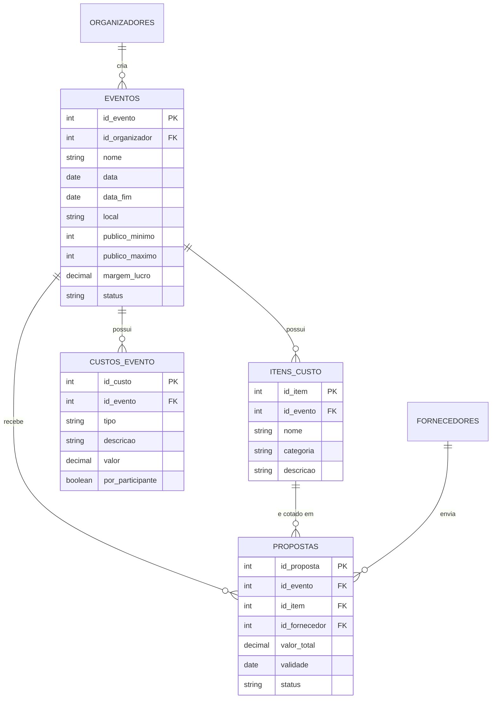

## Módulo de planejamento de eventos (Entrega 2)

Banco: **PostgreSQL (Supabase)**. Script: [`database/02_modulo_planejamento.sql`](../../../src/entrega2/backend/database/02_modulo_planejamento.sql).
Este módulo estende o modelo da Entrega 1: o organizador planeja o evento, define os itens que
precisa contratar, recebe propostas de fornecedores e a plataforma calcula o ticket.

### Diagrama relacional (parte nova)

### Tabela `eventos` (campos acrescentados)

| Campo | Tipo | Restrição | Descrição |
|---|---|---|---|
| data_fim | DATE | `>= data` | Último dia do evento (período = data a data_fim) |
| publico_minimo | INT | `> 0` | Cenário mínimo de público |
| publico_maximo | INT | `>= publico_minimo` | Cenário máximo de público |
| margem_lucro | NUMERIC(5,2) | `>= 0` e `< 100`, padrão 0 | Margem em %, aplicada sobre a receita |
| status | VARCHAR(20) | `rascunho`, `aberto`, `fechado`, `cancelado` | Padrão `rascunho`. Antes: planejado/confirmado/encerrado |

### Tabela `itens_custo` (nova)

| Campo | Tipo | Restrição | Descrição |
|---|---|---|---|
| id_item | INT | PK | Identificador |
| id_evento | INT | FK → eventos, `ON DELETE CASCADE` | Evento que precisa do item |
| nome | VARCHAR(100) | NOT NULL | Ex.: "Iluminação do palco" |
| categoria | VARCHAR(30) | `iluminacao`, `alimentacao`, `bebida`, `seguranca`, `estrutura`, `outros` | Categoria do item |
| descricao | TEXT | | Detalhes para o fornecedor cotar |
| criado_em | TIMESTAMPTZ | padrão NOW() | Data de criação |

### Tabela `custos_evento` (nova)

| Campo | Tipo | Restrição | Descrição |
|---|---|---|---|
| id_custo | INT | PK | Identificador |
| id_evento | INT | FK → eventos, `ON DELETE CASCADE` | Evento |
| tipo | VARCHAR(20) | `fiscal`, `operacional`, `variavel`, `outro` | Natureza do custo |
| descricao | VARCHAR(150) | NOT NULL | Ex.: "Alvará e taxas" |
| valor | NUMERIC(12,2) | `>= 0` | Valor total, ou valor por pessoa (ver abaixo) |
| por_participante | BOOLEAN | padrão FALSE | TRUE: o valor é por pessoa e é multiplicado pelo público |
| criado_em | TIMESTAMPTZ | padrão NOW() | Data de criação |

### Tabela `propostas` (campos acrescentados)

| Campo | Tipo | Restrição | Descrição |
|---|---|---|---|
| id_item | INT | FK → itens_custo, `ON DELETE CASCADE` | Item que a proposta atende |
| descricao | TEXT | | O que está sendo oferecido |
| validade | DATE | | Até quando o preço vale |
| observacoes | TEXT | | Informações adicionais |
| status | VARCHAR(20) | `enviada`, `aceita`, `recusada`, `cancelada` | Situação da proposta |

Regras de integridade no banco:
- no máximo **uma** proposta `aceita` por item (índice único parcial `uq_proposta_aceita_por_item`);
- no máximo **uma** proposta ativa (`enviada` ou `aceita`) por fornecedor em cada item (`uq_proposta_ativa_por_fornecedor`);
- ao excluir um evento (em rascunho), seus itens e custos são excluídos junto (`ON DELETE CASCADE`).

### Cálculo do ticket (regra de negócio)

Margem definida sobre a **receita**:

- `ticket de equilíbrio = custo total / público`
- `ticket-alvo = custo total / [público × (1 − margem)]`
- `custo total (para um público p) = propostas aceitas + custos de valor total + (custos por participante × p)`

Hipóteses: um único tipo de ingresso por evento; o valor de cada proposta é o total do item; os cenários
obrigatórios são público mínimo e máximo (o público esperado é opcional).
Arredondamento: **sempre para cima**, na segunda casa decimal, para que o ingresso nunca fique abaixo do necessário.
Validações: público inteiro maior que zero; margem de 0 a 99,99%; custo maior ou igual a zero.

Exemplo: custo R$ 10.000, público 100, margem 20% → equilíbrio R$ 100,00 e ticket-alvo R$ 125,00.
